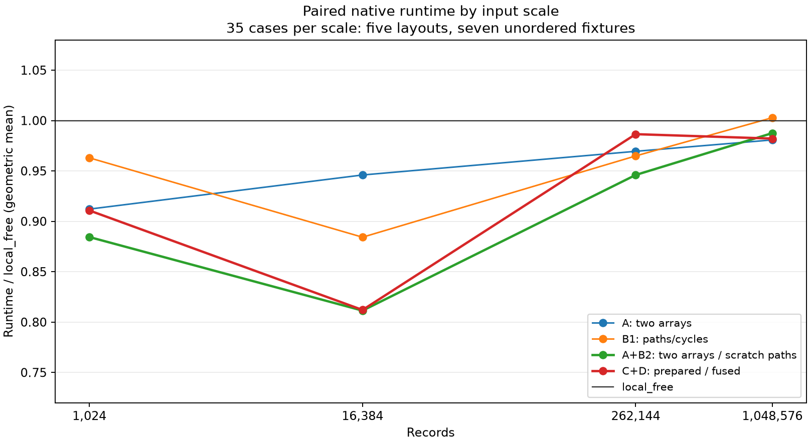
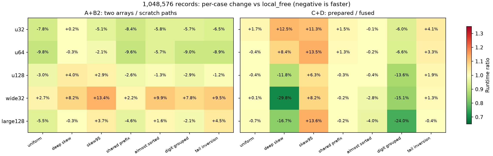

# Block MSD 减工作实验：749ca4d 后续结果

基线固定为 `749ca4d163cbfa93a9e47d67c03db80d8b71bc22`，实施依据为 [上传计划](PLAN.md)。本轮完成了完整工作账本、三个独立实验、单调性融合消融、两组相容组合、归位目录遍历修订，以及独立的生命周期准入实验。

**本次主口径最低耗时几何均值是 `two_arrays_scratch_paths`：相对 `local_free` 为 0.9118，约快 8.82%；原有 75 个场景为 0.9116，约快 8.84%。** 它在 105 个主要场景中有 65 个快超过 5%、35 个在 ±5% 内、5 个慢超过 5%。收益集中在中等规模，百万档的整体收益只有约 1.25%。这不是“每个输入都更快”的结论。

另一组 `hybrid_prepared_fused` 的主口径比值为 0.9232，约快 7.68%；原有集合约快 5.45%。它对部分深偏斜和 digit 已分组输入更有优势，仍保留为独立候选，没有建立按类型或分布选择后端的策略。

## 1. 实现与证据范围

| 名称 | 改动 | 保持的条件 |
| --- | --- | --- |
| `cached_two_arrays`（A） | counts 原地转为累计终点，保留 heads | 相同 digit 树、叶子区间、payload scratch、检查与 cache 准入 |
| `cycle_placement`（B1） | 尾块先归位，空位路径与环旋转 | 原块分桶、scratch、blocks/inverse 目录及销毁时机 |
| `scratch_path_cycles`（B2） | 从 scratch 的唯一源追到路径空位，替代全目标槽寻找空位 | 与 B1 完全相同的记录写入、分配和最终结果 |
| `hybrid_prepared`（C） | 被拒根的当前 counts/剩余位数接续给 Stream | K=4 gate、原 cache 条件、完整旧 scratch 预留；后代仍检查 ordered |
| `hybrid_fused_mono`（D） | 在 histogram 中收集当前 digit 的完整单调证据 | 不增加 record 遍历或 extract；保留比较与状态成本 |
| `live_admission`（E） | 两数组内核按同时存活阶段与祖先 histogram 估算准入 | 独立于 gated 组合；256 KiB 仍是工作集条件 |

A+B1 为 `two_arrays_cycles`；A+B2 为 `two_arrays_scratch_paths`；C+D 为 `hybrid_prepared_fused`。未尝试所有开关的排列组合。E 没有合入 gated 后端，原 gate 对 cache 完成子节点的预测与势函数证明保持原条件。

源码入口分别在 [reduction_node.rs](../src/reduction_node.rs)、[reduction_gate.rs](../src/reduction_gate.rs)、[reduction_stream.rs](../src/reduction_stream.rs) 与 [reduction_admission.rs](../src/reduction_admission.rs)。原始 `node_local.rs`、`materialization_gate.rs`、`combined_stream.rs` 和旧原始数据没有被替换。

## 2. 测量方法与选择口径

机器为 AMD Ryzen 7 8845H，固定 CPU 0；Rust 1.99.0 / LLVM 23.1.1，`-C target-cpu=native`。固定 radix=8、块长=64、原 cache 条件=256 KiB、叶子阈值=128；Block LSD 512 单独标为块长 512。完整环境见 [environment.json](environment.json)。

四尺度为 1,024、16,384、262,144、1,048,576；五布局为 u32/u64/u128/wide32/large128；十分布沿用 749ca4d，包括严格反序、digit 已分组与最后一对逆序。所有稳定候选用完整记录身份和序号对照稳定排序；ordinary 只承诺有序 key 和完整身份置换。

- 第一轮：200 个 case × 15 方法 × 15 个轮换样本，**45,000 次完整排序计时**；方法列表见 [PHASE1.md](PHASE1.md)。
- 第二轮：200 个 case × 14 方法 × 14 个轮换样本，**39,200 次完整排序计时**。表 4 列出其中的候选与参照。
- 聚焦：百万记录、4 分布、3 布局、10 方法 × 20 样本，**2,400 次完整排序计时**，在同一批次重新加入 ordinary、stable_fixed、LSD 两设置与 Rust stable。
- 另有自然 cache 准入点、dyadic 边界、2,000 次内部内核计时、完整 untimed 工作与 allocator 探针。

每个 case 复用同一输入地址，恢复和 oracle 校验在计时外；分配与释放在计时内。轮换平衡方法出现的位置；没有对所有前序方法组合做平衡。取每个 case 的时间中位数，再计算不加规模权重的比值几何均值。±5% 是描述区间，不是显著性检验。两轮各自与同批控制配对，不拼接 749ca4d 的绝对时间。

`primary105`：三个较大尺度 × 五布局 × 原五个非有序分布及两个 digit 分布。`original75`：只保留原五个非有序分布。1,024、已排序、descending、严格反序仍完整测量，单独保存在数据中，不用于挑选主候选。

## 3. 三个独立实验与融合消融

下表均相对自己的直接控制；比值小于 1 表示更快。

| 候选 | 直接控制 | primary105 | original75 | 快 >5% / ±5% / 慢 >5% |
| --- | --- | --- | --- | --- |
| cached_two_arrays | reduction_control | 0.9743 | 0.9755 | 20 / 85 / 0 |
| cycle_placement | reduction_control | 0.9517 | 0.9465 | 24 / 73 / 8 |
| hybrid_prepared | hybrid_control | 0.9639 | 0.9574 | 35 / 70 / 0 |
| hybrid_fused_mono | hybrid_independent_mono | 0.9897 | 1.0022 | 8 / 97 / 0 |

三个控制副本相对冻结实现的主口径比值分别是 1.0001、0.9970、1.0009。所有 200 个 case 的旧工作字段完全一致。初始接口校准发现的额外开销已通过“prepared 只在根接续”以及原生 hybrid 复用冻结 node-local 内核处理；原校准资料保存在 [calibration_initial](calibration_initial/README.md)，不参与上述结果。

A 的收益不能全部归因于 allocator：它同时改变了前缀数组的表示与生成代码。记录级工作相同，具体内核对照见第 7 节。B1 少写很多，但有 8 个主要 case 相对直接控制慢超过 5%。C 没有这类回退，且计数证实只删除实际重复的准备。D 相对独立扫描约快 1.03%；在 original75 上为 1.0022，微小回退，主要收益来自两个 digit 场景。

## 4. 组合与后续实验

本表是第二轮相对同批 `local_free` 的结果。

| 方法 | primary105 | original75 | 快 >5% / ±5% / 慢 >5% |
| --- | --- | --- | --- |
| cached_two_arrays | 0.9653 | 0.9672 | 38 / 66 / 1 |
| cycle_placement | 0.9493 | 0.9426 | 35 / 65 / 5 |
| scratch_path_cycles | 0.9383 | 0.9347 | 38 / 62 / 5 |
| two_arrays_cycles | 0.9183 | 0.9155 | 63 / 37 / 5 |
| two_arrays_scratch_paths | 0.9118 | 0.9116 | 65 / 35 / 5 |
| hybrid_prepared | 0.9503 | 0.9513 | 30 / 62 / 13 |
| hybrid_fused_mono | 0.9487 | 0.9776 | 39 / 46 / 20 |
| hybrid_prepared_fused | 0.9232 | 0.9455 | 39 / 52 / 14 |
| live_admission | 0.9495 | 0.9517 | 49 / 56 / 0 |
| admission_control | 0.9370 | 0.9415 | 51 / 54 / 0 |
| block_lsd512 | 0.9770 | 0.8927 | 54 / 6 / 45 |
| std_stable | 1.0717 | 0.8943 | 26 / 3 / 76 |

最快组合的分尺度结果（各 35 个非有序 case）如下：

| n | 耗时比值 | 几何均值下降 | 慢 >5% 的 case |
| --- | --- | --- | --- |
| 1024 | 0.8844 | 11.56% | 0 |
| 16384 | 0.8114 | 18.86% | 0 |
| 262144 | 0.9460 | 5.40% | 0 |
| 1048576 | 0.9875 | 1.25% | 5 |

B2 相对 B1 为 0.9884；A+B2 相对 A+B1 为 0.9929。其增量收益较小。百万聚焦组中，两组合之间全部在 ±5% 内，A+B2/A+B1 为 1.0012；该组 A+B2/local_free 为 1.0116，反而约慢 1.16%。因此“主口径最低”不能外推成稳定的逐场景领先，B2 也没有解决深偏斜慢例。



## 5. 百万记录的同批聚焦对照

单位 ms，均为 20 样本中位数。wide32 同时改变键宽与记录宽，不能把差异只归因于 `sizeof(T)`。`std_stable` 是该 Rust 工具链的 `sort_by_key`，不是 Timsort 实测。

### uniform

| 方法 | u32（ms） | wide32（ms） | large128（ms） |
| --- | --- | --- | --- |
| local_free | 10.519 | 23.339 | 67.071 |
| two_arrays_cycles | 9.508 | 23.548 | 64.720 |
| two_arrays_scratch_paths | 9.591 | 23.806 | 64.568 |
| hybrid_prepared | 10.446 | 22.684 | 67.040 |
| hybrid_prepared_fused | 10.521 | 23.148 | 67.503 |
| ordinary | 8.654 | 33.653 | 109.915 |
| stable_fixed | 8.370 | 33.338 | 110.681 |
| block_lsd | 4.348 | 93.823 | 79.837 |
| block_lsd512 | 3.360 | 74.147 | 92.408 |
| std_stable | 14.691 | 40.357 | 167.932 |

### deep_skew

| 方法 | u32（ms） | wide32（ms） | large128（ms） |
| --- | --- | --- | --- |
| local_free | 6.019 | 85.600 | 111.125 |
| two_arrays_cycles | 6.020 | 92.009 | 113.901 |
| two_arrays_scratch_paths | 6.045 | 92.457 | 113.224 |
| hybrid_prepared | 6.634 | 59.756 | 94.768 |
| hybrid_prepared_fused | 6.716 | 59.890 | 95.171 |
| ordinary | 4.112 | 275.378 | 282.725 |
| stable_fixed | 4.136 | 282.256 | 284.479 |
| block_lsd | 3.312 | 34.225 | 51.017 |
| block_lsd512 | 2.724 | 46.388 | 49.471 |
| std_stable | 10.699 | 11.984 | 90.772 |

### digit_grouped

| 方法 | u32（ms） | wide32（ms） | large128（ms） |
| --- | --- | --- | --- |
| local_free | 9.597 | 19.017 | 53.726 |
| two_arrays_cycles | 8.994 | 20.356 | 55.576 |
| two_arrays_scratch_paths | 9.029 | 20.323 | 55.156 |
| hybrid_prepared | 9.680 | 18.311 | 55.922 |
| hybrid_prepared_fused | 8.972 | 16.060 | 42.345 |
| ordinary | 8.486 | 28.657 | 101.668 |
| stable_fixed | 8.306 | 29.152 | 102.673 |
| block_lsd | 4.619 | 95.837 | 87.742 |
| block_lsd512 | 3.535 | 73.526 | 93.338 |
| std_stable | 15.204 | 37.002 | 164.968 |

### digit_tail_inversion

| 方法 | u32（ms） | wide32（ms） | large128（ms） |
| --- | --- | --- | --- |
| local_free | 9.560 | 19.541 | 56.197 |
| two_arrays_cycles | 8.998 | 21.348 | 61.489 |
| two_arrays_scratch_paths | 9.002 | 21.376 | 61.380 |
| hybrid_prepared | 9.627 | 18.935 | 57.852 |
| hybrid_prepared_fused | 9.912 | 19.567 | 59.143 |
| ordinary | 8.438 | 26.781 | 102.112 |
| stable_fixed | 8.262 | 26.685 | 102.018 |
| block_lsd | 4.504 | 95.443 | 87.961 |
| block_lsd512 | 3.478 | 78.009 | 99.309 |
| std_stable | 16.173 | 38.108 | 162.738 |

这些数据仍显示明显的场景边界：随机 u32 上，最快 MSD 组合仍慢于 ordinary、stable_fixed 和 Block LSD；随机大记录上则有显著优势。wide32 深偏斜中，C+D 虽从 85.600 ms 降到 59.890 ms，仍远慢于 Rust stable 的 11.984 ms。large128 分组输入的 C+D 为 42.345 ms，末尾逆序则为 59.143 ms，仍比 local_free 的 56.197 ms 慢。

## 6. 完整工作与空间账本

[validate.py](validate.py) 和 [validate_stage2.py](validate_stage2.py) 对全部 200 个 case 检查记录工作、分配与空间关系。

百万随机 u32：

| 指标 | local_free | A+B2 |
| --- | ---: | ---: |
| 完整排序 alloc/realloc 次数 | 1,040 | 784 |
| 累计申请 heap 字节 | 6,351,496 | 5,827,208 |
| 峰值请求 heap 字节 | 557,768 | 557,768 |
| 归位记录写入 | 2,078,528 | 1,048,640 |

两数组恰好删除 256 次 end-array 分配、524,288 字节累计申请；原 histogram、scatter/copyback 和叶子输入完全相同。峰值由根块工作区决定，故不下降。A+B2 在 200/200 个 case 中的请求 heap 峰值都不高于 local_free；B1/B2 彼此的 heap、总申请和记录写入完全相同。

uniform 的峰值请求 heap（MiB）：

| 方法 | u32 | wide32 | large128 |
| --- | --- | --- | --- |
| local_free | 0.532 | 1.421 | 4.467 |
| two_arrays_scratch_paths | 0.532 | 1.421 | 4.467 |
| hybrid_prepared_fused | 0.532 | 1.421 | 4.467 |
| block_lsd512 | 1.034 | 8.034 | 32.034 |
| std_stable | 4.000 | 16.000 | 64.000 |

这些数不包括输入、oracle、stack、allocator header/rounding 或 RSS。256 KiB 不是整个排序的硬辅助内存上限。固定块长下 `O(n/b)` 目录仍随 n 线性增长；本轮没有新增平方根空间声明。完整生命周期与工具链叶子 scratch 审计见 [SPACE.md](SPACE.md)。

百万 wide32 深偏斜的完整 hybrid histogram 工作从 17,744,963 降至 16,696,387，variation 同样少 1,048,576 条访问；scatter、归位和叶子分布不变。局部归位计数为零不再被误解为总搬运为零：fallback 的 Writer、gather 与最终归位已纳入总账。

单调性融合不新增 record 遍历或 extract，但仍增加比较、依赖与状态；独立扫描的末尾逆序负例没有被删掉。B1/B2 的路径与环证明约束记录写入量，不约束时间，也没有测得足以解释全部慢例的硬件计数器。

## 7. 对齐工作后的内部 u32 内核

预分配同一大小的记录工作区，固定相同节点输入、digit 树与叶子区间。histogram/cursor 分配、记录搬运和叶子排序在计时内；ordered、variation、Verge 与整个排序的 scratch 分配不在这个内部测试内。每轮核对相同 scatter 节点数、记录数及叶子调用数。参照只在内置 u32、已证明 digit 范围内调用冻结的四项展开 scatter；通用 cached 内核保留全部边界与初始化检查。

| n | cached 三数组（µs） | cached 两数组 | copy/scatter + key leaf | copy/scatter + partial leaf |
| --- | ---: | ---: | ---: | ---: |
| 1,024 | 3.65 | 3.28 | 3.08 | 2.92 |
| 4,096 | 17.14 | 16.24 | 14.12 | 14.44 |
| 16,384 | 142.60 | 138.50 | 132.74 | 132.20 |
| 65,536 | 605.25 | 560.27 | 520.20 | 519.71 |
| 262,144 | 2,236.82 | 2,072.43 | 1,871.55 | 1,890.92 |

两数组有改善，但与既有 copy/scatter 内核仍有差距。这支持继续研究同工作内核成本；不能把整个 MSD/LSD 差距全归因于根归位，也不能把几何均值收益全算作省一次 malloc。

## 8. 生命周期准入与没有继续展开的分支

E 将活跃祖先 histogram 的容量、cached 两数组各阶段的最大同时占用、一次完整记录 scratch 和工具链叶子 scratch 界纳入工作集估计。部分 digit 的最大占用可能出现在较浅层，因此逐层取 max。它没有改变 gated 组合的 cache 条件，避免把新的上下文依赖准入混入原摊还证明。

根节点全部位宽变化时，自然准入边界及 `old_limit+1` 的 uniform 对照如下（µs，12 样本）：

| 布局 | 旧上限 | 新上限 | 测量 n | 相同内核旧准入 | 生命周期准入 | 比值 |
| --- | --- | --- | --- | --- | --- | --- |
| u32 | 28608 | 31488 | 28609 | 261.757 | 248.753 | 0.9503 |
| u64 | 12736 | 15232 | 12737 | 81.067 | 76.128 | 0.9391 |
| u128 | 4800 | 7104 | 4801 | 35.246 | 31.514 | 0.8941 |
| wide32 | 2368 | 3520 | 2369 | 18.039 | 14.758 | 0.8181 |
| large128 | 832 | 928 | 833 | 36.544 | 27.201 | 0.7443 |

边界点有局部收益，主矩阵却没有证实普遍收益：E/E-control 的 primary105 为 1.0134，original75 为 1.0109；没有主要 case 快超过 5%，有 16 个慢超过 5%。主矩阵只有 4 个 case 的全树工作聚合发生变化，峰值 heap 全部相同。因此不能把所有回退都解释成“扩大 cache 更慢”；判断开销、承载代码及测量变动也未完全分离。E-control 自身比 A 快约 2.93%，但两者的树、记录工作和所有分配指标相同，这个差异不能记成准入策略收益。E 保留为独立研究候选，未合入最低均值组合。

全部 admitted 工作集估计均不超过 256 KiB；对主矩阵和边界中 root-cached 的 case，实测 `input_bytes + peak_requested_heap` 也不超过此值。这不覆盖非 cached 的块工作区，也不涵盖用户 extractor 自己的任意分配。

本轮按证据停止了两个分支：

- 跨入口元数据复用：selected phase 的 setup 时间中位占比约 1.66%、最大 8.14%，并且包含分配以外的 setup 工作。未证明 allocator 已成为主要成本，故不新增延长生命周期的 workspace。
- cached ping-pong：103/105 个主要 case 的可节省写入为零。只有 16,384 条 u32 的 deep_skew、skew95 分别有 65,408、31,138 条记录写入机会；百万 uniform 的 cached 子树全部只有一层 scatter。没有为两个局部 case 引入新的双缓冲初始化与 panic 恢复机制。



## 9. 仍需正视的慢例

第二轮主矩阵中，各组合相对 local_free 的最慢几个 case：

| 候选 | 布局 | 输入 | n | 耗时比 |
| --- | --- | --- | --- | --- |
| two_arrays_scratch_paths | wide32 | skew95 | 1048576 | 1.1337 |
| two_arrays_scratch_paths | wide32 | almost_sorted | 1048576 | 1.0989 |
| two_arrays_scratch_paths | wide32 | digit_tail_inversion | 1048576 | 1.0955 |
| two_arrays_scratch_paths | wide32 | deep_skew | 1048576 | 1.0815 |
| two_arrays_scratch_paths | wide32 | digit_grouped | 1048576 | 1.0779 |
| hybrid_prepared_fused | u32 | deep_skew | 262144 | 1.1607 |
| hybrid_prepared_fused | large128 | skew95 | 262144 | 1.1435 |
| hybrid_prepared_fused | large128 | skew95 | 1048576 | 1.1357 |
| hybrid_prepared_fused | u64 | skew95 | 1048576 | 1.1348 |
| hybrid_prepared_fused | u32 | deep_skew | 1048576 | 1.1251 |

没有加类型/分布选择表、更多 gate、padding/内联搜索，也没有因少写而忽略这些回退。现阶段可证的是稳定性、明确的空间生命周期、减少的确定工作与限定输入集合上的收益；不能宣称每种输入都胜过稳定排序。

## 10. 验证、版本与复现

- 新算法已通过 debug/release 的完整泛型 oracle，覆盖 radix/块/叶子边界、满/部分尾块、深链、负数、浮点转换、带身份重复 key 和 NaN payload。
- B1/B2 的具体 Rust 测试检查 17,399 个注入映射；独立 [Python 模型](block_model.py) 检查身份、owner、未初始化 padding、写入公式与 B2/B1 写入相等。有限模型不替代 Rust 指针与生命周期验证。
- ASAN 分别验证诊断配置与原生算法配置，含变化 extractor 的边界/panic 检查；不承诺违反 key 契约后的排序语义或新的 panic-permutation 语义。
- 全 targets/features 编译检查、crate 测试与 doctest 检查均有日志；所有计时行都完成了对应的排序/身份验证。

第一阶段源码冻结于 [0669c11](https://github.com/Yikai-Liao/voracious_sort/commit/0669c11e09f07b06c21a70fafc6291b49410677d)。第二阶段按 [stage2-source-sha256.txt](stage2-source-sha256.txt) 与 [stage2-binary-sha256.txt](stage2-binary-sha256.txt) 配对。第一阶段 ELF 的未改动副本及原 hash 见 `stage1-preserved-binary-sha256.txt`；第二阶段构建没有替代第一阶段的测量证据。

原始数据：`normal-N.csv`、`combined-N.csv`、`focused-1048576.csv`、`diagnostics-N.csv`、`phase2-diagnostics-N.csv`、`dyadic-N.csv`、`cache-layout-N.csv`、`phase2-cache-layout-N.csv`、`kernel-comparison.csv`。汇总为 `stage1-*`、`phase2-*`、`focused-*`，准入全树工作差异为 [admission-effects.csv](admission-effects.csv)。CSV 使用 LF；measurement、analysis、source/binary ledger 分开保存。

当前源码复现第二阶段：

```sh
export MSD_REDUCTION_OUT=/tmp/block-msd-reduction-rerun
experiments/block_msd/work_reduction/run.sh combined
python3 experiments/block_msd/work_reduction/run.py phase2_diagnostics
python3 experiments/block_msd/work_reduction/run.py phase2_boundaries
```

第一阶段精确源码请使用 0669c11 的独立 checkout；当前源码的 `full` 套件不能替换它的 hash。聚焦套件、数据分析与核对命令记录在 [REPRODUCE.md](REPRODUCE.md)。

最低均值候选的实验入口：

```rust
use block_msd_research::reduction_node::{self, Placement};
let mut values = vec![3u32, 1, 2, 1];
let stats = reduction_node::sort_reduced::<u32, u32>(
    &mut values, 8, 64, reduction_node::CACHE_BUDGET,
    Placement::ScratchPathCycles, true, // 两数组 cached 内核
);
```

本轮保持实验模块边界，没有替换主库默认排序。
